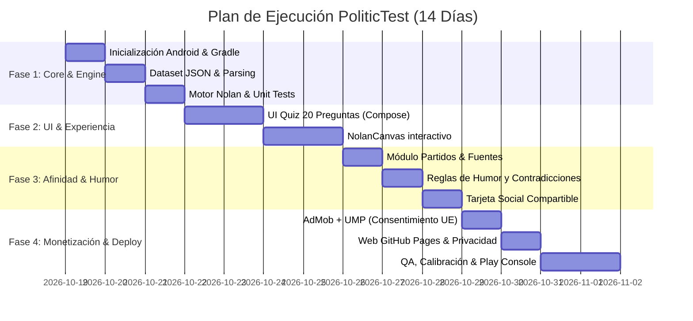

# Arquitectura Técnica y Plan de Proyecto: PoliticTest (Elecciones 2026)

## 1. Bases Metodológicas Definitivas

Siguiendo la decisión aprobada, el motor y el cuestionario se fundamentan en la versión de **20 preguntas del Test de Nolan (*The World's Smallest Political Quiz*)**, adaptada rigurosamente al marco sociopolítico y económico español.

### 1.1. Estructura del Cuestionario
- **Total de preguntas:** 20 preguntas invariables en su esquema metodológico.
  - **10 preguntas de Libertad Económica:** Regulación de mercados, fiscalidad, pensiones, gasto público, subsidios, privatización/nacionalización, mercado laboral, vivienda y comercio.
  - **10 preguntas de Libertad Personal:** Derechos civiles, libertad de expresión, bioética (eutanasia, aborto), privacidad y vigilancia, laicidad, inmigración y fronteras, drogas y sustancias, y modelo familiar.
- **Escala de respuesta y ponderación:**
  Cada pregunta admite 5 opciones discretas. La puntuación atribuida por pregunta es:
  - **Totalmente de acuerdo:** 10 puntos (o 0 si la pregunta está formulada en sentido inverso).
  - **Parcialmente de acuerdo:** 7 puntos (o 3 si es inversa).
  - **Neutral / Postura intermedia:** 5 puntos (en cualquier orientación).
  - **Parcialmente en desacuerdo:** 3 puntos (o 7 si es inversa).
  - **Totalmente en desacuerdo:** 0 puntos (o 10 si es inversa).
- **Rango de puntuación por eje:**
  $$\text{Puntuación en cada eje} = \sum_{i=1}^{10} \text{Puntos}(q_i) \quad \in [0, 100]$$
  - **Eje X (Libertad Económica):** 0 (Máximo intervencionismo / Planificación estatal) a 100 (Libre mercado irrestricto).
  - **Eje Y (Libertad Personal):** 0 (Máximo control social / Autoritarismo estatal) a 100 (Máxima autonomía y libertades individuales).

### 1.2. Límites Geométricos de las 5 Regiones Ideológicas (Diagrama de Nolan)
En el plano cartesiano $[0, 100] \times [0, 100]$, definimos las 5 regiones ideológicas mediante límites geométricos continuos y deterministas:

```
      Libertad Personal (Y)
  100 ┌───────────────────┬───────────────────┐
      │                   │                   │
      │    PROGRESISTA    │    LIBERTARIO     │
      │    (Izquierda)    │                   │
      │         ┌─────────┴─────────┐         │
   50 │         │     CENTRISTA     │         │
      │         └─────────┬─────────┘         │
      │    ESTATISTA      │    CONSERVADOR    │
      │   (Autoritario)   │     (Derecha)     │
      │                   │                   │
    0 └───────────────────┴───────────────────┘
      0                  50                 100  Libertad Económica (X)
```

**Reglas de clasificación geométrica:**
1. **Región Centrista (Rombo central):**
   Se define por la distancia de Manhattan normalizada al centro $(50, 50)$:
   $$\text{Es Centrista si } |X - 50| + |Y - 50| \le 25$$
   *(Garantiza una zona de moderación en forma de diamante centrada en 50, coherente con la tradición clásica de Nolan).*
2. **Si el punto $(X, Y)$ está fuera del rombo central:**
   - **Libertario:** $X \ge 50$ e $Y \ge 50$
   - **Progresista (Izquierda social):** $X < 50$ e $Y \ge 50$
   - **Conservador (Derecha tradicional):** $X \ge 50$ e $Y < 50$
   - **Autoritario / Estatista:** $X < 50$ e $Y < 50$

> [!IMPORTANT]
> **Prioridad de coordenadas:** La aplicación mostrará siempre en primer plano las coordenadas exactas `(X: 72, Y: 45)` y los porcentajes antes de la etiqueta. Si un usuario se encuentra a menos de 5 puntos de una frontera geométrica, la interfaz mostrará un matiz (ej. *"Conservador con tendencia al centro"*).

---

## 2. Módulo de Comparación Electoral (Desacoplado)

El módulo electoral es un componente analítico independiente que **no contamina** el cálculo de Nolan.

### 2.1. Vector de Calibración de Partidos Políticos
Cada partido político analizado cuenta con una postura tipificada y documentada para **cada una de las 20 preguntas del cuestionario**:
$$\vec{P}_j = (p_{j,1}, p_{j,2}, \dots, p_{j,20}), \quad p_{j,i} \in \{0, 3, 5, 7, 10\} \cup \{\text{NULL}\}$$
- Si un partido no tiene una postura oficial conocida o verificada sobre una pregunta concreta, se asigna `NULL` (Dato no disponible).
- **Transparencia obligatoria:** En el JSON y en la web se incluye el campo `source_url` y `justification` con citas de programas electorales oficiales, votaciones en el Congreso de los Diputados o iniciativas legislativas parlamentarias.

### 2.2. Cálculo de Coincidencia Programática
Para un usuario con vector de respuestas $\vec{U} = (u_1, u_2, \dots, u_{20})$:
1. Se identifican las preguntas comparables: $C_j = \{ i \in [1..20] \mid p_{j,i} \neq \text{NULL} \}$.
2. Si $|C_j| < 12$ (menos del 60% de las preguntas tienen postura documentada), la app muestra: *"Comparación incompleta por falta de posicionamiento parlamentario contrastado"*.
3. Para los partidos con información suficiente, se calcula la discrepancia media normalizada:
   $$\text{Discrepancia}_j = \frac{1}{|C_j|} \sum_{i \in C_j} \frac{|u_i - p_{j,i}|}{10}$$
   $$\text{Afinidad Programática}_j = (1 - \text{Discrepancia}_j) \times 100\%$$
4. **Desglose de coincidencias y discrepancias:**
   La UI mostrará para cada partido:
   - Los 2 temas de mayor acuerdo ($|u_i - p_{j,i}| \le 2$).
   - Los 2 temas de mayor desacuerdo ($|u_i - p_{j,i}| \ge 7$).
   - Disclaimer explícito: *"Medición de coincidencia programática en base a las 20 cuestiones evaluadas. No constituye un pronóstico electoral ni una recomendación de voto."*

---

## 3. Motor Humorístico y Detección de Contradicciones

El motor humorístico opera **exclusivamente a posteriori** sobre el par $(X, Y)$ y el vector de respuestas $\vec{U}$, sin alterar nunca las puntuaciones matemáticas.

### 3.1. Niveles de Humor y Sátira
1. **Titular del Perfil (Arquetipo base por cuadrante/subzona):**
   - *Libertario puro:* «Cripto-anarquista que sueña con privatizar las aceras».
   - *Progresista estatista:* «Activista con fe ciega en la capacidad reguladora del BOE».
   - *Conservador clásico:* «Nostálgico del orden familiar y de la cuenta corriente en Suiza».
   - *Centrista estricto:* «El hombre gris: te parece bien todo y a la vez todo lo contrario».
2. **Detección de Contradicciones Específicas (Reglas lógicas predefinidas):**
   - *Regla fiscal vs. gasto:* Alta exigencia de rebaja impositiva ($q_{\text{impuestos}} \ge 7$) combinada con rechazo tajante al copago o recortes en servicios públicos ($q_{\text{sanidad}} \le 3$).
     - *Diagnóstico:* «El milagro de los panes y los peces: buscas servicios nórdicos a precio de paraíso fiscal».
   - *Regla de libertades individuales vs. seguridad:* Exigir despenalización absoluta de hábitos privados pero reclamar censura o presencia policial invasiva en la calle.
     - *Diagnóstico:* «Bohemio pero solo hasta el toque de queda».

---

## 4. Esquema del Dataset JSON Versionado (`electoral_dataset_v1.json`)

Toda la lógica de contenido está separada del binario:

```json
{
  "$schema": "https://politictest.es/schemas/dataset-v1.json",
  "dataset_version": 20261021,
  "min_app_version_code": 1,
  "methodology": {
    "engine": "Nolan-20",
    "economic_questions_count": 10,
    "personal_questions_count": 10,
    "score_range": [0, 100]
  },
  "questions": [
    {
      "id": "econ_01",
      "axis": "ECONOMIC",
      "index": 1,
      "text": "El mercado laboral debe desregularse para facilitar la contratación y el despido sin tutela estatal.",
      "favorable_to_freedom": true,
      "topic": "Mercado Laboral"
    },
    {
      "id": "pers_01",
      "axis": "PERSONAL",
      "index": 11,
      "text": "El Estado no debe intervenir en decisiones morales individuales como la eutanasia o el aborto.",
      "favorable_to_freedom": true,
      "topic": "Bioética y Autonomía"
    }
  ],
  "parties": [
    {
      "id": "psoe",
      "name": "Partido Socialista Obrero Español",
      "acronym": "PSOE",
      "nolan_coordinates": { "economic": 35, "personal": 70 },
      "answers": {
        "econ_01": 0,
        "pers_01": 10
      },
      "sources": {
        "econ_01": "Programa Electoral 2023, pág. 45 - Rechazo a la flexibilización del despido.",
        "pers_01": "Votación Ley Orgánica 3/2021 de regulación de la eutanasia."
      }
    }
  ],
  "archetypes": [
    {
      "id": "arch_libertarian_tech",
      "condition": { "min_x": 75, "min_y": 75 },
      "title": "Cripto-filósofo del libre albedrío",
      "description": "Tu utopía es un mundo sin impuestos, sin licencias de obras y donde los contratos se resuelvan por blockchain."
    }
  ],
  "tension_rules": [
    {
      "id": "tension_low_tax_high_spend",
      "condition": {
        "and": [
          { "question_id": "econ_01", "operator": "GTE", "value": 7 },
          { "question_id": "econ_03", "operator": "LTE", "value": 3 }
        ]
      },
      "badge": "Paradoja del bienestar caribeño",
      "commentary": "Reclamas menos tributos pero máximas prestaciones sociales. Recuerda que los hospitales no se financian con buenos deseos."
    }
  ]
}
```

---

## 5. Arquitectura Técnica de la Aplicación Android

### 5.1. Repositorio Local y Paquetes
- **Ruta del proyecto:** `C:\Users\ramse\AndroidStudioProjects\PoliticTest`
- **Application ID:** `es.politictest.app`
- **Módulos / Estructura de Paquetes:**
  ```
  app/src/main/java/es/politictest/app/
  ├── core/
  │   ├── model/          // Data classes inmutables: Question, Answer, Axis, NolanResult, Party
  │   ├── scoring/        // NolanCalculator (puro, determinista, 0 dependencias Android)
  │   ├── comparison/     // PartyAffinityCalculator, AgreementFinder
  │   ├── humor/          // ArchetypeResolver, TensionDetector
  │   └── data/           // DatasetRepository (Carga asset local + caché local + sync remoto)
  ├── feature/
  │   ├── onboarding/     // Presentación, disclaimer legal y neutralidad
  │   ├── quiz/           // Paginador de las 20 preguntas (Compose), progreso y selector 5 opciones
  │   ├── result/         // NolanCanvas (Rombo y ejes), barras de partidos, arquetipo y contradicciones
  │   ├── share/          // Generador de imagen Bitmap off-screen y Action Send
  │   └── methodology/    // Pantalla de fuentes documentadas y justificación por partido
  └── ui/
      └── theme/          // Material 3 con colores neutros no partidistas (Slate/Indigo/Teal)
  ```

### 5.2. Testing y Determinismo
- **Pruebas unitarias de rigor en `core:scoring`:**
  1. *Test de Coordenadas Extremas:* 20 respuestas "Totalmente de acuerdo" en favor de la libertad $\to (100, 100)$ (Libertario puro).
  2. *Test de Respuestas Inversas:* 20 respuestas "Totalmente en desacuerdo" $\to (0, 0)$ (Estatista puro).
  3. *Test de Neutralidad:* 20 respuestas "Neutral" $\to (50, 50)$ (Centro exacto).
  4. *Test de Fronteras de Región:* Validación de los límites del rombo ($|X-50| + |Y-50| \le 25$).
  5. *Test de Invariabilidad:* El cálculo electoral o el humor nunca modifican las coordenadas de Nolan.

---

## 6. Plan de Implementación de 14 Días (Ajustado)



### Hitos de Entrega
- **Hito 1 (Día 3):** Motor de cálculo con cobertura de tests al 100% y dataset JSON de 20 preguntas validado.
- **Hito 2 (Día 6):** Flujo completo del test ejecutable en emulador/dispositivo (Onboarding $\to$ 20 preguntas $\to$ Nolan Canvas).
- **Hito 3 (Día 9):** Pantalla de resultados con partidos documentados, arquetipo humorístico y tarjeta compartible en PNG.
- **Hito 4 (Día 11):** Anuncios AdMob con UMP y Web de Metodología y Privacidad activa en GitHub Pages.
- **Hito 5 (Día 14):** Subida del bundle AAB a Google Play Console listo para revisión y lanzamiento.
